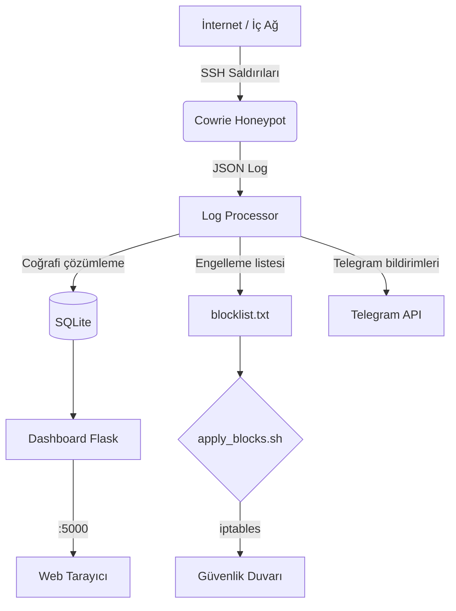

# Konteyner Tabanlı Honeypot ve Güvenlik Paneli

Bu proje, **HPC (Yüksek Başarımlı Hesaplama)** ortamlarında veya herhangi bir sunucu altyapısında kullanılabilecek, **gerçek zamanlı saldırı tespiti, analizi ve aktif savunma** yeteneklerine sahip bir **honeypot sistemi**dir. Cowrie SSH honeypot’u ile saldırganların davranışları izlenir, coğrafi konum analizi yapılır, anlık Telegram bildirimleri gönderilir ve şüpheli IP’ler iki aşamalı bir mekanizma ile güvenlik duvarına eklenir.

> 🎓 Bu proje, yazılım mühendisliği 2. sınıf stajı kapsamında, HPC ve sistem yönetimi ile siber güvenlik kesişiminde geliştirilmiştir.

---

## ✨ Özellikler

- **Cowrie SSH Honeypot:** Sahte bir SSH sunucusu ile saldırganları tuzağa düşürür, tüm komutları ve etkileşimleri kaydeder.
- **Gerçek Zamanlı Web Paneli:** Flask + Bootstrap ile oluşturulmuş, olayları canlı olarak gösteren dashboard.
- **Coğrafi Konum Analizi:** Saldırgan IP’lerinin ülke, şehir ve koordinat bilgileri otomatik olarak çözümlenir, panelde bayraklarla gösterilir.
- **Telegram Anlık Bildirimleri:** Kritik olaylar (başarılı giriş, komut çalıştırma, dosya indirme) anında Telegram’a mesaj olarak düşer.
- **İki Aşamalı IP Engelleme:**
  1. Saldırı tespit edildiğinde IP otomatik olarak **bekleme listesine** alınır.
  2. Güvenlik operatörü onayıyla `apply_blocks.sh` betiği çalıştırılarak IP **iptables** ile kalıcı olarak engellenir.
- **Tamamen Konteyner Tabanlı:** Docker ve Docker Compose ile tüm servisler izole ve taşınabilir. Tek komutla kurulum.
- **Tekrarlayan Saldırılara Karşı Akıllı Filtre:** Zaten engellenmiş bir IP tekrar saldırdığında listeye mükerrer kayıt eklenmez.
- **Sahte Veri Üretici (`seed_data.py`):** Demo ve sunum amaçlı, farklı ülkelerden gelmiş gibi görünen sahte saldırı kayıtları oluşturur.

---

## 🧱 Mimari




---

## 🛠️ Kullanılan Teknolojiler

| Bileşen          | Teknoloji / Dil           |
|------------------|---------------------------|
| Honeypot         | Cowrie (Python)           |
| Log İşleyici     | Python 3.11               |
| Web Panel (Backend) | Flask (Python)         |
| Web Panel (Frontend) | HTML5, CSS3, Bootstrap 5, JavaScript |
| Veritabanı       | SQLite                    |
| Konteyner        | Docker, Docker Compose    |
| Bildirim         | Telegram Bot API          |
| Coğrafi Konum    | ip-api.com (ücretsiz API) |
| Güvenlik Duvarı  | iptables (Linux)          |
| Demo / Test      | Bash, sshpass             |

---

## 📋 Gereksinimler

- **Docker** ve **Docker Compose** (güncel sürüm)
- **sshpass** (demo betiği için, isteğe bağlı)
- **Telegram Bot Token** ve **Chat ID** (bildirimler için)

---

## Kurulum ve Çalıştırma

### 1. Depoyu klonlayın
```bash
git clone https://github.com/hazal-hk/konteyner-tabanli-honeypot-agi
cd konteyner-tabanli-honeypot-agi
```

### 2. Ortam değişkenlerini ayarlayın
```bash
cp .env.example .env
nano .env   # TELEGRAM_BOT_TOKEN ve TELEGRAM_CHAT_ID bilgilerinizi girin
```

### 3. Sistemi başlatın
```bash
docker-compose up -d --build
```

### 4. Paneli açın
```
Tarayıcınızdan http://localhost:5000 adresine gidin.
```

## Demo Senaryosu
Otomatik saldırı simülasyonu

```bash

chmod +x demo.sh
./demo.sh
```

Bu betik, honeypot’a çeşitli başarısız/başarılı SSH girişleri yapar ve komutlar çalıştırır.
Paneli gözlemleyin

    -Olaylar tablosu canlı olarak güncellenir.

    -“Engellenen IP’ler” kartında saldırgan IP’si “bekliyor” durumunda belirir.

    -Telegram bildirimlerini alırsınız.


## IP’yi kalıcı olarak engelleme
```bash

chmod +x apply_blocks.sh
./apply_blocks.sh
```

Panelde aynı IP’nin rozeti “engellendi” (yeşil) olarak değişir.
## Engellemeyi doğrulamak için:
```bash

sudo iptables -L INPUT -v -n
```

## (İsteğe bağlı) Sahte geçmiş verisi ekleme
```bash

docker cp seed_data.py log-processor:/tmp/seed_data.py
docker exec log-processor python3 /tmp/seed_data.py
```

## Proje Yapısı
```
.
├── docker-compose.yml        # Servis orkestrasyonu
├── .env.example              # Ortam değişkenleri şablonu
├── demo.sh                   # Otomatik saldırı simülasyonu
├── apply_blocks.sh           # IP engelleme betiği
├── seed_data.py              # Sahte veri üretici
├── cowrie/                   # Cowrie yapılandırması (opsiyonel)
├── processor/                # Log işleyici Python uygulaması
│   ├── Dockerfile
│   ├── requirements.txt
│   └── log_processor.py
├── dashboard/                # Flask web paneli
│   ├── Dockerfile
│   ├── requirements.txt
│   ├── app.py
│   └── templates/
│       └── index.html
└── data/                     # (Çalışma anında oluşur) SQLite DB ve blocklist

```

## Güvenlik Notları
```
    .env dosyanızı asla commit’lemeyin. Depoda yalnızca .env.example şablonu bulunur.

    Telegram token’ınızı projeyi yayınladıktan sonra yenilemeniz önerilir (BotFather → Revoke token).

    data/ klasörü .gitignore ile tamamen hariç tutulmuştur.
```

## Lisans

Bu proje MIT lisansı ile lisanslanmıştır. Ayrıntılar için LICENSE dosyasına bakınız.

## Teşekkürler

    Cowrie - SSH/Telnet Honeypot

    ip-api.com - Ücretsiz IP coğrafi konum servisi

    Bootstrap - Arayüz bileşenleri

Bu projenin geliştirme sürecinde, mimari kararlar ve akademik rehberlik konusundaki değerli katkılarından ötürü staj sorumlum/hocam **Öskan BARUTÇUOĞLU**'na teşekkür ederim.

📧 İletişim

Proje ile ilgili sorularınız için: hazal.karayigit.06@gmail.com
                                   www.linkedin.com/in/hazal-karayigit/
